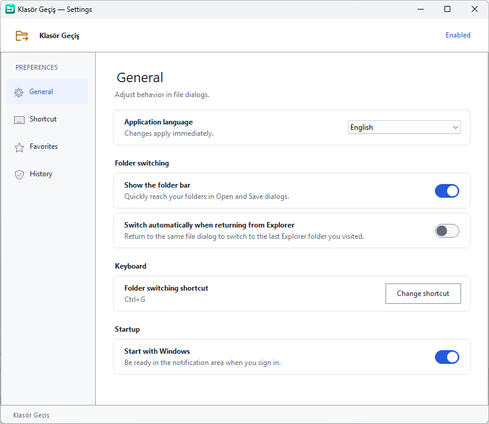

# Klasör Geçiş

[English](#english) · [Türkçe](#türkçe)

## English

**Preview release:** [Download v0.5.0](https://github.com/inceof/klasor-gecis/releases/tag/v0.5.0).
Choose the Setup EXE to install, or the portable ZIP and extract all files.
Keep the included license notices. This is an unsigned build; verify the
SHA-256 file published with the release.

Switch an application's **Open / Save** dialog to a folder open in File Explorer
with one click or **Ctrl+G**. A small Windows x64 utility built with .NET 10 and
WinForms, running in the notification area. Version **0.5.0**.

Six built-in languages: **Türkçe, English, 中文（简体）, हिन्दी, Español, العربية**.
Choose a language in **Settings → General → Application language**. The choice
is saved and applied immediately; existing profiles keep Turkish by default.
Arabic uses right-to-left layout. Folder names and paths remain unchanged.

Open a folder in File Explorer, open another application's standard Open/Save
dialog, then click the folder bar or press Ctrl+G. The menu also offers favorite
and recent folders. History and automatic switching are opt-in.

To build on Windows, install .NET SDK 10.0.300 and run `./build.ps1` in PowerShell.
It builds and runs rule/checksum tests, then produces the self-contained
`release/win-x64/KlasorGecis.exe`. Building the six-language installer additionally
requires Inno Setup 6; compile `installer/KlasorGecis.iss` after building the EXE.

Custom file pickers, elevated targets, real network shares and mixed-DPI setups
may behave differently. Controlled Windows Sandbox install/reinstall/uninstall
and 0.4.0-to-0.5.0 upgrade checks passed. The final notice-only setup rebuild
was checked by extracting and matching its files. Visual installer, physical
device/accessibility and native-speaker translation review remain unvalidated. See the Turkish development
instructions below for test commands. Source code is [MIT licensed](LICENSE);
third-party installer translation credits remain in `installer/Languages`.

## Türkçe

**Ön sürüm:** [v0.5.0 indir](https://github.com/inceof/klasor-gecis/releases/tag/v0.5.0).
Kurulum için Setup EXE'yi, taşınabilir kullanım için ZIP'i seçip tüm dosyaları
çıkarın. Lisans dosyalarını koruyun. Paket kod imzalı değildir; sürüm sayfasındaki
SHA-256 dosyasıyla indirdiğiniz dosyanın özetini karşılaştırabilirsiniz.

Windows Dosya Gezgini'nde açık olan klasöre, başka bir uygulamanın **Aç / Kaydet**
penceresinden tek tıklamayla veya **Ctrl+G** ile geçin.

.NET 10 ve WinForms ile yazılmış, bildirim alanında çalışan bir Windows x64
yardımcısıdır. Güncel uygulama sürümü **0.5.0**.

**Türkçe, English, 中文（简体）, हिन्दी, Español, العربية** dilleri dahildir.
**Ayarlar → Genel → Uygulama dili** alanından seçim yapabilirsiniz. Dil anında
uygulanır ve kaydedilir; mevcut profiller Türkçe kalır. Arapça sağdan sola
düzen kullanır. Klasör adları ve yollar çevrilmez. Setup da altı dili sunar;
kurulum dili ile uygulamada kaydedilen dil birbirinden bağımsızdır.



## Özellikler

- Dosya penceresine bağlı, odak almayan klasör geçiş satırı.
- Açık Explorer klasörleri, favoriler ve isteğe bağlı son klasörler menüsü.
- Değiştirilebilir genel kısayol; varsayılan **Ctrl+G**.
- Genel, Kısayol, Favoriler ve Geçmiş ayarları.
- Dosya adı, dosya türü ve giriş odağını korumaya yönelik kontroller.
- İsteğe bağlı otomatik geçiş ve Windows ile başlangıç.

## Kullanım

1. Programı çalıştırın; bildirim alanında klasör simgesi görünür.
2. Dosya Gezgini'nde kullanmak istediğiniz klasörü açın.
3. Başka bir uygulamada standart Aç veya Kaydet penceresini açın.
4. Geçiş satırına tıklayın veya **Ctrl+G** kullanın. Sağdaki menüden başka bir
   klasör, favori veya son klasör seçebilirsiniz.

Tercihler bildirim alanındaki **Ayarlar…** komutundadır. Otomatik geçiş ve
geçmiş başlangıçta kapalıdır. Programı **Çıkış** komutuyla kapatabilirsiniz.

## Kaynaktan derleme

Windows x64 ve **.NET SDK 10.0.300** gerekir (`global.json`). Proje klasöründe PowerShell açın:

```powershell
.\build.ps1
```

Betik derler, kural/regresyon ve SHA-256 kontrollerini çalıştırır ve .NET çalışma
zamanını içeren taşınabilir `release\win-x64\KlasorGecis.exe` üretir.
Kaynak klasörünün adı ve konumu sabit değildir. GUI testleri otomatik başlamaz.

Kurulum dosyası için önce yukarıdaki EXE'yi derleyin; ardından **Inno Setup 6** ile:

```powershell
& "$env:LOCALAPPDATA\Programs\Inno Setup 6\ISCC.exe" .\installer\KlasorGecis.iss
```

Derleyici farklı konumdaysa komuttaki ISCC.exe yolunu değiştirin.
Setup `release\setup` altında oluşur; mevcut kullanıcıya kurulur.
Derlenmiş EXE ve setup dosyaları kaynak deposunun dışında tutulur.

## Testler ve sınırlar

```powershell
dotnet build .\tests\KlasorGecis.Tests\KlasorGecis.Tests.csproj -c Release
dotnet run --project .\tests\KlasorGecis.Tests\KlasorGecis.Tests.csproj -c Release --no-build
```

Canlı testler için çalışan Klasör Geçiş örneğini kapatın; aşağıdaki komutu ayrı
çalıştırın. Test fareyi ve odağı kullanır, kontrollü Explorer pencereleri oluşturur.
Canlı test gruplarını aynı anda çalıştırmayın.

```powershell
$test = '.\tests\KlasorGecis.Tests\bin\Release\net10.0-windows\KlasorGecis.Tests.exe'
Start-Process -FilePath $test -ArgumentList '--source-suite --out verification\sources.json' -Wait
```

Standart Windows Aç/Kaydet pencereleri hedeflenir. Özel dosya seçiciler, sanal
klasörler ve yönetici yetkili uygulamalar farklı davranabilir. Gerçek UNC,
fiziksel karma DPI, ekran okuyucu ve kurulum/yükseltme/kaldırma kabulü tüm
senaryolar için doğrulanmış değildir. Hata bildirirken Windows sürümünüzü,
hedef uygulamayı ve yeniden üretme adımlarını belirtin; kişisel dosya yollarını
ve gizli bilgileri paylaşmadan önce çıkarın.

## Veri ve lisans

Tercihler `%LOCALAPPDATA%\KlasorGecis` altında saklanır. İzin verilirse son
klasörler ve ilgili uygulama kaydedilir; dosya adları ve yazılan metinler geçmişe
eklenmez. Tanılama kaydı da bu klasördedir.

Bu projenin kaynak kodu [MIT lisansı](LICENSE) ile sunulur.
.NET ve derleme araçlarının lisansları kendi bileşenlerine aittir.
Katkılar ve hata bildirimleri memnuniyetle karşılanır.

Distributions include `LICENSE`, `THIRD-PARTY-NOTICES.md` and `licenses/`. Keep these with the portable EXE. / Taşınabilir EXE ile birlikte bu lisans dosyalarını da saklayın.

## Automated checks / Otomatik kontroller

GitHub Actions builds on Windows using .NET SDK 10.0.300, runs the existing
rule tests and checksum checks (PowerShell 7 and 5.1), and stores portable files
with license notices for 7 days. Native UI and installer acceptance are separate.
The workflow runs after publication; local checks alone do not prove a hosted CI run.

GitHub Actions her değişiklikte Windows derlemesini ve mevcut testleri çalıştırır.
GUI/kurulum testleri bu akışa dahil değildir.
